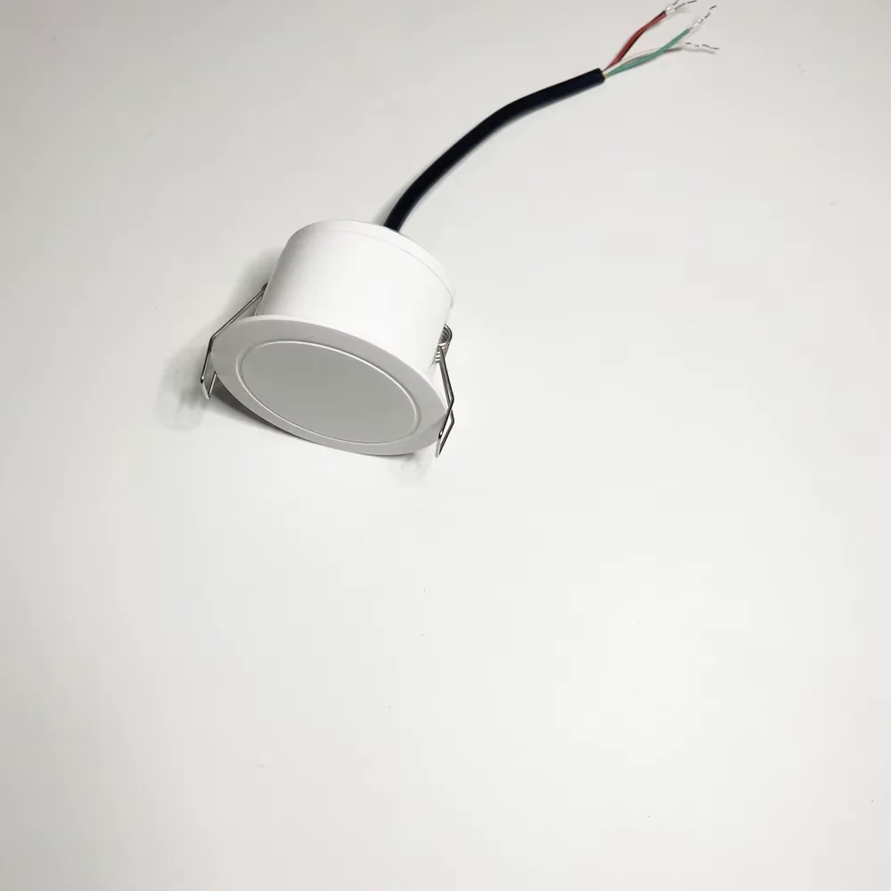
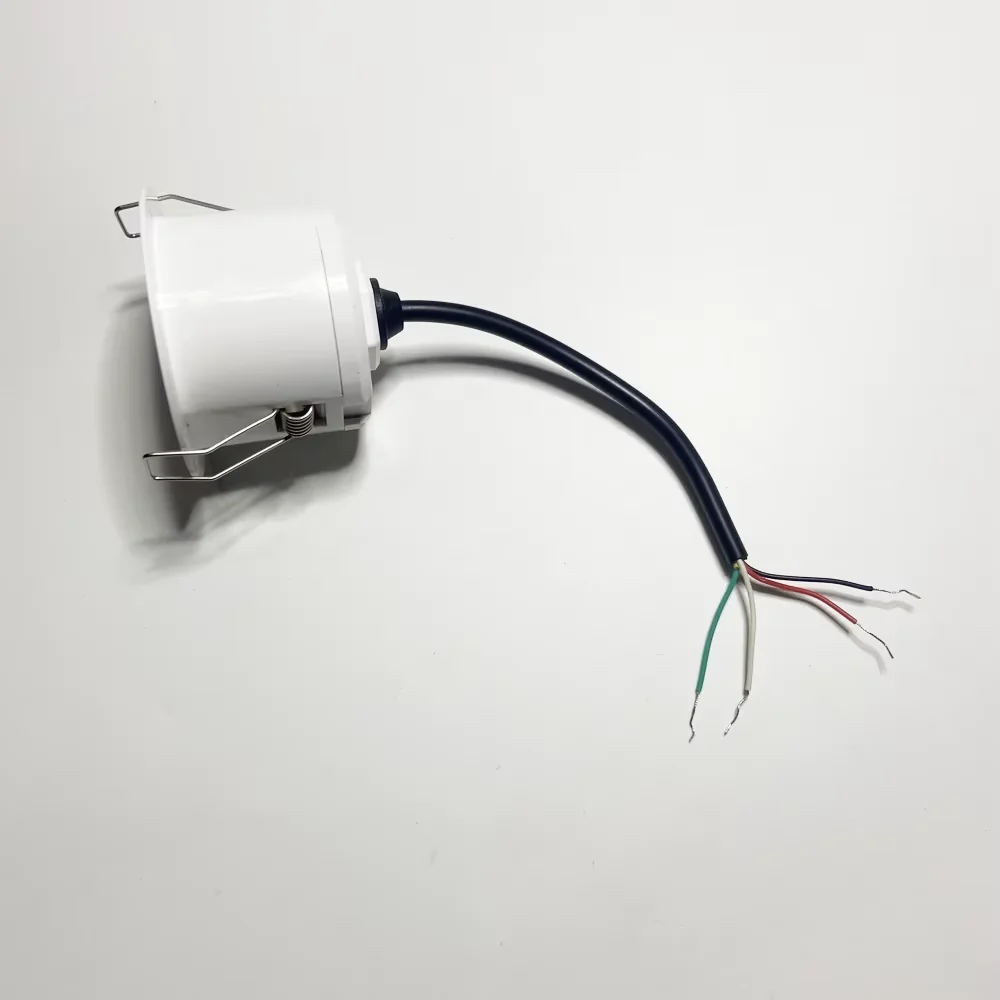
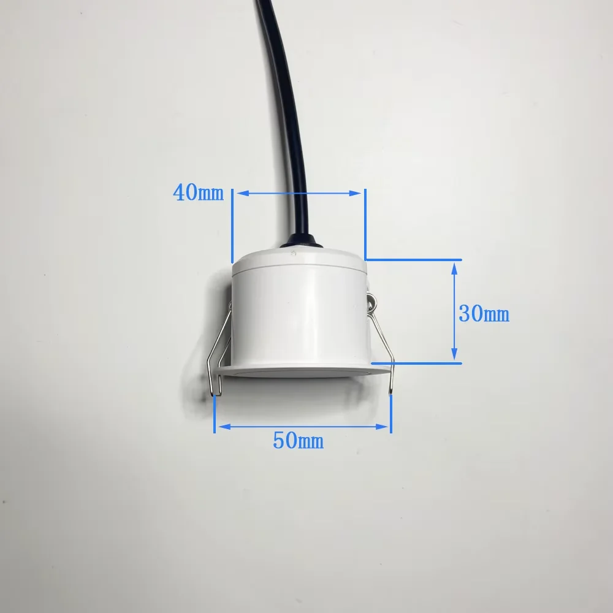

# mtdx62

Device library for the **MTD062-MB** (5.8 GHz) and **MTD262-MB** (24 GHz) human presence
sensors, spoken to over Modbus RTU or Modbus TCP.

The library models the sensor's registers as typed Python attributes. It reads the whole
measurement block in one Modbus request and keeps the configuration registers separate, so
polling the sensor does not drag along parameters that rarely change.

Built on [`modbus-connection`](https://home-assistant-libs.github.io/modbus-connection/): the
caller owns the connection and hands over a `ModbusUnit`. The library never opens a socket or a
serial port and has no dependency on Home Assistant.

The dependency is pinned to `modbus-connection>=4.12.8`. Earlier releases close a connection and
reopen it when a unit asks for a longer timeout, which races with the next request
([issue 269](https://github.com/home-assistant-libs/modbus-connection/issues/269)); 4.12.8 keeps
the link open instead. On a serial bus that race shows up as a port that refuses to open until
the stale connection goes away.

## The device

Ceiling-mounted radar sensor. It reports presence, ambient light and the distance to the detected
target, and keeps its own configuration in holding registers.

### The family

One housing, four models: two speak Modbus, two switch a dry contact. Only the Modbus ones are
covered by this library, and the register map is identical between them.

| Model | Radio | Interface | Covered here |
|---|---|---|---|
| MTD062-MB | 5.8 GHz | Modbus RTU over RS485 | yes |
| MTD262-MB | 24 GHz | Modbus RTU over RS485 | yes |
| MTD061-RC | 5.8 GHz | dry contact, ≤ 24 V, ≤ 100 mA | no |
| MTD261-RC | 24 GHz | dry contact, ≤ 24 V, ≤ 100 mA | no |

Both kinds are configured with the same infrared remote. The manuals for the Modbus and the
dry-contact series are both in [`docs/sources/`](https://github.com/sergeyastakhov/mtdx62-modbus-library/tree/main/docs/sources), so the difference is visible
before buying the wrong one.

Devices that look the same are also sold under other names, and Bluetooth variants exist. Check
the label before buying: this library speaks Modbus RTU only.

### Outside

| | | |
|---|---|---|
|  |  |  |
| *Overview with the infrared remote* | *Angled view* | *Side view* |



*Dimensions, millimetres*

### Inside

| | |
|---|---|
|  |  |
| *Inside all three hardware versions, angled* | *Inside all three hardware versions, front* |

Pictures come from the vendor's product material. What the device actually does — register
values, the self-check timeline, how it reacts to a cut bus — is in
[`docs/DEVICE-FACTS.md`](https://github.com/sergeyastakhov/mtdx62-modbus-library/blob/main/docs/DEVICE-FACTS.md).

## Install

```bash
pip install mtdx62-modbus-library
```

## Use

```python
import asyncio

from modbus_connection import ModbusTcpParams
from modbus_connection.tmodbus import ModbusConnection
from mtdx62_modbus_library import Mtdx62Device


async def main() -> None:
    connection = ModbusConnection(ModbusTcpParams(host="192.168.1.50", port=502))
    try:
        device = Mtdx62Device(connection.for_unit(1))

        await device.async_update_readings()
        print(device.readings.presence, device.readings.illuminance, device.readings.distance)

        await device.async_update_settings()
        print(device.settings.detection_distance, device.settings.departure_delay)
    finally:
        await connection.close()


asyncio.run(main())
```

## What it exposes

| Attribute | Meaning | Unit |
|---|---|---|
| `readings.presence` | a person is detected, including someone sitting still | — |
| `readings.illuminance` | ambient light as the sensor sees it | lx, tenth of a lux |
| `readings.distance` | distance to the detected target | m, centimetre resolution |
| `readings.status_code` | raw health code | — |
| `readings.status` | health code as `DeviceStatus`, `None` when unknown | — |
| `readings.app_version` | application firmware version, `1.2.3` | — |
| `readings.radar_version` | radar module firmware version | — |
| `settings.*` | detection range, delays, sensitivities, bus address and speed | see `Settings` |

Every attribute is `None` until the first read of its sub-system.

Illuminance comes with a tenth-of-a-lux resolution and a ceiling: the unit we tested stops at
11280, which is 1128 lx, and stays there in brighter light. Treat that as the behaviour of one
device — another unit may saturate elsewhere — and do not use the ceiling as a scale bound.

The number is the sensor's own reading. Nobody compared it against a reference meter, so treat it
as a relative signal — enough to tell dark from bright, not as a calibrated lux value.

Reading the configuration is a separate call (`async_update_settings()`) precisely so that a
5-second poll costs one request.

## Writing parameters

Every parameter the vendor register map describes can be written; `0x000D` cannot, because nobody
knows what it holds. The value is expressed in the units the reading uses, and the library checks it
against the map before anything reaches the bus:

```python
await device.settings.async_write("departure_delay", 60)
await device.settings.async_write("detection_distance", 4.5)

for spec in device.settings.writable_fields():
    print(spec.name, spec.minimum, spec.maximum, spec.step, spec.unit)
```

`writable_fields()` is what a UI should build its controls from: name, limits, step, unit and the raw
register bounds, so the range is not copied into a second place.

`settings.mac_code` is the one register the vendor calls a MAC code. It is a single word, not a full
MAC address — on the unit we tested it reads `1` — so it is exposed for diagnostics and cannot be
written.

After the write the library reads the parameter block and compares. A device that stores something
else raises `WriteVerificationError` carrying both values instead of pretending the write worked; a
successful call leaves `settings` filled from that same read, so no extra poll is needed.

Write is a tool, not a policy. The library deliberately does **not**:

- check the device's health code first — a script changing ten parameters would pay ten extra reads,
  and whether a faulting device should be configured is the caller's call;
- change the unit's own address, baud rate or parity when those registers are written, or reconnect;
- know that `active_report = 1` makes the device talk on its own.

### What the sensor does with the value

The vendor table is not the whole truth, and `docs/DEVICE-FACTS.md` records what was measured on a
real unit:

- **The sensor clamps instead of rejecting.** Detection distance below 1.0 m is stored as 1.0 m, the
  shielding zone below 0.3 m as 0.3 m, and neither raises an error. The library therefore refuses
  values outside the measured ranges, so you get what you asked for or a clear `ValueError`.
- **A new value appears with a delay.** For up to half a second a read can still return the previous
  number. The confirmation read is repeated for a second before `WriteVerificationError` is raised,
  so a slow sensor is not mistaken for a rejected write.
- **The zones must fit inside the detection radius:** `shielding_distance + entry_indent` must stay
  below `detection_distance`. The sensor enforces it and answers with exception `0x02`, which reads
  like "illegal address" rather than "illegal value". The library does not predict this; the error
  comes from the device.
- **`unit_id`, `baudrate` and `parity` apply at once**, not after a power cycle: the moment the write
  lands, the device answers on the new address or speed. A caller that changes them has to move its
  link with them, or it loses the sensor until it does. These three are written **without a
  confirmation read** — there is nothing to read back — and `async_write_link_settings()` sends all
  three as one request, filling the values you do not pass from the last read.
- **`active_report` switches the device into push mode.** On a shared bus that means frames nobody
  asked for, so a poll-based consumer should leave it off.
- The threshold is expressed in the same tenths of a lux as the reading: `10.0` is 10 lux, which the
  device stores as 100; the register accepts up to 4200, that is 420 lx.

## Health codes

`readings.status` is a `DeviceStatus` member. A running sensor reports `OK` (1); code 0 is the
transient self-check at power-up, and code 2 and above mean the sensor is broken. `is_fault`
tells the two groups apart, so consumers do not have to remember the boundary.

| Code | Meaning | `is_fault` |
|---|---|---|
| 0 | self-check in progress | no |
| 1 | running | no |
| 2 | self-test failed | yes |
| 3 | other fault | yes |
| 4 | radar module fault | yes |
| 5 | RS485 fault | yes |
| 6 | radar and RS485 fault | yes |

An undocumented code decodes to `None`, while `status_code` keeps the raw number for diagnostics.

> **0.2.0 is a breaking release**: `OK` and `SELF_TEST_FAILED` swapped values, because 0.1.0 read
> the vendor table one row off.

## Errors

The library raises whatever `modbus-connection` raises: a timeout, a protocol error, or a
refusal of the addressed registers. It does not wrap them, so the caller can tell a dead link
from a slow device.

Its own errors derive from `Mtdx62Error`, so one `except` clause catches them all:

| Error | When |
|---|---|
| `WriteVerificationError` | the device accepted the write but reports a different value; carries `field`, `requested` and `stored` |

A value outside the register map, or of the wrong type, raises `ValueError` before anything is sent.
An unknown or unwritable parameter raises `AttributeError`.

## Supported firmware

Written against the vendor documentation for firmware **1.6**. The register map is in
`openspec/specs/mtdx62-registers/`, and what the device actually does — register values, the
self-check timeline, how it reacts to a cut bus — is in [`docs/DEVICE-FACTS.md`](https://github.com/sergeyastakhov/mtdx62-modbus-library/blob/main/docs/DEVICE-FACTS.md)
together with the vendor material it was derived from.

## Tests

Tests run against the in-memory backend of `modbus-connection`, so they need neither hardware
nor Home Assistant:

```bash
pip install -e ".[test]"
pytest
```

## Author

Sergey Astakhov — [sergeyastakhov@mail.ru](mailto:sergeyastakhov@mail.ru),
[github.com/sergeyastakhov](https://github.com/sergeyastakhov).

Source and issues: <https://github.com/sergeyastakhov/mtdx62-modbus-library>. MIT licensed.
